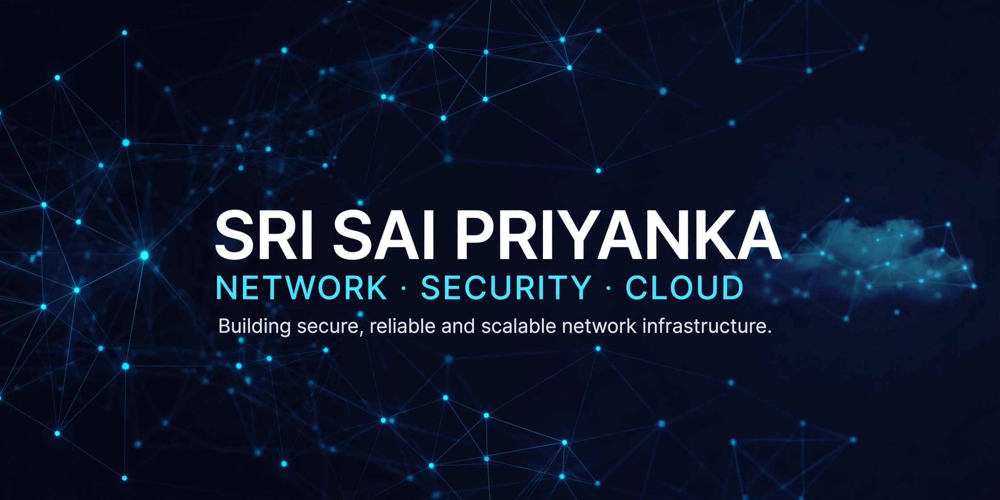
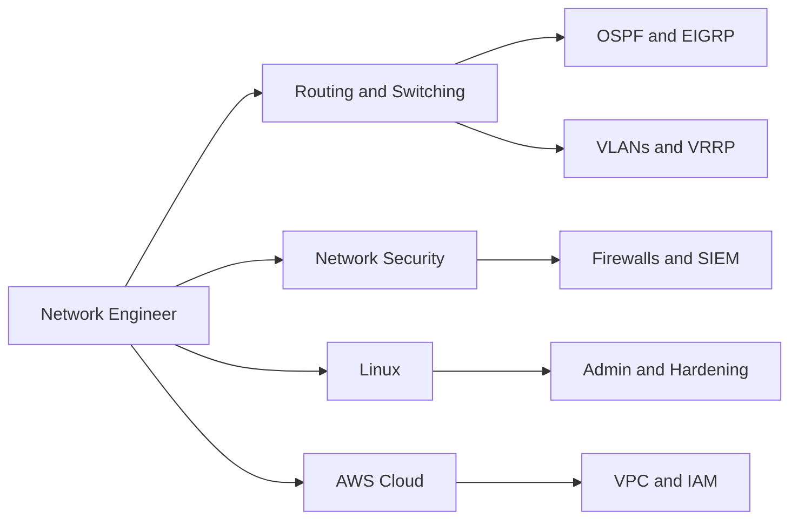

# Network Engineer | Network Security | Cybersecurity | Linux | AWS Cloud Networking

## About Me

I am a Network Engineer with 3+ years of experience in enterprise networking. I have worked on live Cisco networks, handling routing, switching, monitoring, and L1 and L2 troubleshooting every day. I enjoy finding out why a network is slow or down, and I like fixing it properly instead of working around it.

Right now I am building hands-on labs in network security, Linux, and AWS cloud networking. My goal is to grow from network engineering into secure, scalable cloud and enterprise infrastructure. This profile shows the work I have done in production, the labs I have built, and the topics I am learning next.

## Professional Experience

This is my real work history, taken from my resume. Nothing here is invented, and no numbers are added that I cannot back up.

### Provin Tech Pvt Ltd, Hyderabad

Network Engineer, Associate Consultant, December 2025 to June 2026

- Ran Wireshark captures on live traffic to find protocol errors, latency, and packet drops
- Managed Inter-VLAN routing through SVIs and Router-on-a-Stick, and kept OSPF states healthy across the network
- Looked after VRRP redundancy so a failed gateway did not take the network down
- Handled DHCP addressing, including the DORA process, along with static routes and ACLs
- Sorted Incidents and Request Items (RITMs) in ServiceNow and Jira, and passed diagnostic logs to L2 and L3 teams when a fault needed deeper work
- Supported rack cabling and hardware maintenance, and helped senior engineers during network upgrades

### TeamLease Services Limited, Bangalore

Network Engineer, Partner Consultant, May 2022 to July 2025

- Watched live network traffic, device health, uptime, and bandwidth every day, and flagged drops in speed or connectivity before users reported them
- Fixed L1 issues like connection drops, internet drops, IP conflicts, slow links, and performance bottlenecks, and worked within SLA timelines
- Set up switch ports, assigned VLANs, turned on trunk and access modes, enabled basic port security, and closed unused ports
- Configured Cisco routers and switches, including the 1900 and 4300 series routers and 2960 and 3850 series switches
- Supported end-to-end network infrastructure across core and access switches and edge routers
- Helped with physical setup, rack mounting, patch panel termination, and structured cabling
- Took regular backups of Cisco IOS configuration files so a failed device could be restored quickly
- Put together weekly and monthly reports on network health, bandwidth use, and SLA compliance

## Enterprise Networking Skills

These are the skills I use in my day to day work.

- TCP/IP and the OSI model, IPv4 and IPv6, subnetting and VLSM
- OSPF and EIGRP, static and default routing
- VRRP and gateway redundancy
- VLANs and Inter-VLAN routing, trunking and access ports
- STP and RSTP, EtherChannel with LACP and PAgP
- DNS, DHCP, ARP, and ICMP, NAT and ACLs
- Cisco IOS on 1900 and 4300 series routers and 2960 and 3850 series switches
- Network monitoring, Wireshark packet analysis, and network troubleshooting
- GNS3 and Cisco Packet Tracer
- ServiceNow and Jira

## Hands-on Lab Experience

These labs come from real work I have done in GNS3 and in live troubleshooting. They are finished labs with full configs and notes.

- Enterprise networking labs, multi-area OSPF with EIGRP, Inter-VLAN routing with VRRP, and STP with EtherChannel, all in GNS3
- Cisco routing and switching configs, baselines for switches and routers, port security, ACLs, NAT, DHCP, and IOS backup and restore
- Wireshark packet analysis, DHCP DORA, ARP and DNS troubleshooting, OSPF states, TCP handshakes, and latency and packet drop analysis
- Network troubleshooting playbook, eight L1 and L2 runbooks with a triage flow and an escalation matrix

## Technical Exposure

These topics are lab templates I am working through. They are not production experience, and they are not finished skills yet. Each repo says so clearly in its status line.

- Network security labs, Palo Alto firewall labs, FortiGate security labs, and a cybersecurity home lab with Kali Linux, Nmap, Nessus, Suricata, Snort, and Wazuh
- SIEM and threat detection, Splunk searches, Wazuh alerts, and MITRE ATT&CK mapping
- Linux administration labs, Ubuntu, Kali Linux, and Red Hat fundamentals, Bash scripting, SSH, cron, iptables, UFW, and TCPdump
- AWS cloud networking labs, VPC, subnets, route tables, NAT gateway, VPC peering, transit gateway, site-to-site VPN, Route 53, and load balancing
- AWS cloud security labs, IAM, GuardDuty, Security Hub, CloudTrail, CloudWatch, and VPC flow logs
- Network automation and DevSecOps exposure, Python fundamentals, Netmiko, Ansible, REST APIs, JSON and YAML, Terraform fundamentals, Docker fundamentals, and CI/CD fundamentals

## Currently Learning

- Palo Alto and FortiGate firewall labs, one rule at a time
- Splunk and Wazuh, writing searches that answer real questions
- AWS VPC networking and IAM with least privilege
- Python automation with Netmiko and Ansible
- Linux hardening and log analysis

## Featured Repositories

| Repository | What it covers | Status |
| --- | --- | --- |
| [enterprise-networking-labs](https://github.com/PriyankaDaggubati-png/enterprise-networking-labs) | GNS3 labs for OSPF, EIGRP, Inter-VLAN routing, VRRP, STP, and EtherChannel | Lab experience |
| [cisco-routing-switching](https://github.com/PriyankaDaggubati-png/cisco-routing-switching) | Baseline Cisco IOS configs for switches and routers | Lab experience |
| [palo-alto-firewall-labs](https://github.com/PriyankaDaggubati-png/palo-alto-firewall-labs) | PAN-OS zones, policies, NAT, and IPsec VPN | Lab template |
| [fortigate-security-labs](https://github.com/PriyankaDaggubati-png/fortigate-security-labs) | FortiOS policies, NAT, IPsec VPN, and SSL VPN | Lab template |
| [cybersecurity-home-lab](https://github.com/PriyankaDaggubati-png/cybersecurity-home-lab) | Kali, Nmap, Nessus, Suricata, Wazuh, OWASP, and MITRE ATT&CK | Lab template |
| [linux-administration-labs](https://github.com/PriyankaDaggubati-png/linux-administration-labs) | Users, services, logs, firewall, and Bash scripting | Lab template |
| [aws-cloud-networking](https://github.com/PriyankaDaggubati-png/aws-cloud-networking) | VPC, subnets, NAT gateway, peering, transit gateway, and VPN | Lab template |
| [aws-cloud-security](https://github.com/PriyankaDaggubati-png/aws-cloud-security) | IAM, GuardDuty, Security Hub, CloudTrail, and flow logs | Lab template |
| [wireshark-packet-analysis](https://github.com/PriyankaDaggubati-png/wireshark-packet-analysis) | DHCP, ARP, DNS, TCP, TLS, OSPF, and security analysis | Lab experience |
| [siem-threat-detection](https://github.com/PriyankaDaggubati-png/siem-threat-detection) | Splunk searches, Wazuh, Suricata, and alert triage | Lab template |
| [network-automation-python](https://github.com/PriyankaDaggubati-png/network-automation-python) | Netmiko, Ansible, REST APIs, Docker, and CI/CD | Lab template |
| [network-troubleshooting-playbook](https://github.com/PriyankaDaggubati-png/network-troubleshooting-playbook) | Eight L1 and L2 runbooks with triage and escalation | Lab experience |

## GitHub Stats

Replace PriyankaDaggubati-png with your real GitHub username in the links below, and the cards will fill in with your real numbers.

Contribution activity grows as labs are finished and pushed. The numbers above are live, so they change as new repos and commits land.

## Education

- B.Tech, Computer Science and Engineering, Jawaharlal Nehru Technological University, Hyderabad, 2018 to 2022, CGPA 6.74

## Career Interests

- Network Engineer and Network Security Engineer roles
- Cloud network engineering on AWS
- Security operations and threat detection
- Enterprise infrastructure with a security first mindset
- Roles where I can keep learning and take on more responsibility

## Contact

- LinkedIn, [www.linkedin.com/in/sri-sai-priyanka-daggubati-54ab45216](https://www.linkedin.com/in/sri-sai-priyanka-daggubati-54ab45216)
- Email, srisaipriyankad@gmail.com

Recruiter keywords, Network Engineer, Network Security Engineer, Cisco, OSPF, EIGRP, VLAN, VRRP, STP, EtherChannel, Wireshark, GNS3, Firewall, Palo Alto, Fortinet, SIEM, Splunk, Wazuh, Linux, AWS, VPC, IAM, Python, Ansible, Nmap, Suricata, SOC, Cloud Networking, Hyderabad, India
